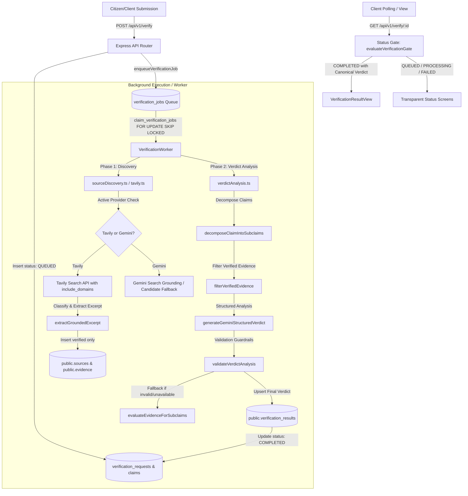

# GovVerify AI — Official-Source Verification Engine: Architecture & System Audit

**Document:** `official_source_verification_audit.md`  
**Status:** Complete (Phase A Deliverable)  
**Date:** October 19, 2026  
**Auditor:** Antigravity AI Engineering Team  

---

## 1. Executive Summary

This architecture audit evaluates the GovVerify AI verification pipeline to prepare for extending the system with a **PIB-inspired, official-source-first verification workflow**. 

GovVerify AI operates as an autonomous, sovereign fact-checking engine for Indian public policy and citizen-facing government announcements. The existing stack comprises:
- **Express.js API Layer** (`server.ts`, `src/server/routes/api.ts`)
- **Tavily Search API & Gemini Flash Model** (`src/server/services/tavily.ts`, `src/server/services/gemini.ts`)
- **Supabase PostgreSQL Database** with strict Row-Level Security (`src/server/supabase.ts`, `supabase/migrations/`)
- **Persistent Background Queue & Autonomous Worker** (`src/server/queue/jobQueue.ts`, `src/server/queue/worker.ts`, `src/server/queue/retryPolicy.ts`)
- **Civic Frontend & Status Gates** (`src/components/dashboard/VerificationResultDetail.tsx`, `VerificationResultView.tsx`)

This audit confirms that:
1. The existing architecture possesses clear extension points to support an authoritative official-source registry, multi-subclaim search generation, live page extraction, and published PIB fact-check discovery.
2. The current database schema (`sources`, `evidence`, `claims`, `verification_requests`, `verification_results`, `verification_jobs`) can represent all new metadata fields **without requiring disruptive or breaking production schema migrations**.
3. All existing guardrails—including 4 canonical verdicts (`SUPPORTED`, `PARTIALLY_SUPPORTED`, `CONTRADICTED`, `INSUFFICIENT_EVIDENCE`), citation traceability, cross-request isolation, status gates, and zero-fabrication rules—will remain strictly preserved.

---

## 2. Existing Pipeline & Extension Points

### 2.1 Complete Request Lifecycle



### 2.2 Key Extension Points Identified

| Component | File Path | Current Role | Extension Point for Official-Source Engine |
| :--- | :--- | :--- | :--- |
| **Domain Classifier & Registry** | `src/server/services/sourceDiscovery.ts` (lines 98–174) | Static heuristic classifying hostnames into Tiers 1–4. | Extract into a modular, configurable **Official Source Registry** (`src/server/services/officialSourceRegistry.ts`) supporting verified domain hierarchies, authority rationale, and SSRF/lookalike domain protections. |
| **Tavily Discovery Service** | `src/server/services/tavily.ts` (lines 96–182, 250–370) | Executes a single coarse query (`site:gov.in ...`) with hardcoded domain array. | Support: (1) query formulation per decomposed subclaim, (2) prioritizing official registry domains first, (3) retrieving raw page content, and (4) extracting authentic passages without rewrites. |
| **Gemini Claim Decomposition** | `src/server/services/verdictAnalysis.ts` (lines 79–154) | Decomposes compound claims into atomic subclaims. | Use structured Gemini decomposition to identify entities, schemes, figures, dates, and circular references for focused official query generation. |
| **Official Fact-Check Adapter** | `src/server/services/tavily.ts` & `src/server/services/sourceDiscovery.ts` | No dedicated fact-check discovery adapter. | Add dedicated **PIB Fact Check Adapter** (`src/server/services/pibFactCheck.ts`) that searches published PIB Fact Check archives (`factcheck.pib.gov.in`, `pib.gov.in`) and clearly tags findings. |
| **Evidence Validation** | `src/server/services/verdictAnalysis.ts` (lines 162–177, 697–809) | `filterVerifiedEvidence` checks `source_type === 'GROUNDED_SEARCH'` and non-empty text. | Add authentic passage verification (verifying excerpt existence in raw page), currency check (`isOutdated`), and semantic relevance to specific subclaims. |
| **Presentation & Audit Trail** | `src/components/dashboard/VerificationResultView.tsx` | Displays verdict, explanation, subclaims, evidence citations, and action guidance. | Expose source classification badges (e.g. *Official Gazette*, *Ministry Press Release*, *PIB Fact Check*), retrieval timestamps, and explicit disclaimers separating automated analysis from government notices. |

---

## 3. Current Source Provenance Rules

Under GovVerify AI's existing implementation:

1. **Provenance Classification**:
   - `GROUNDED_SEARCH`: Verified authoritative government evidence retrieved via live search grounding and containing substantive raw text (>80 characters). Only these are persisted to `public.evidence`.
   - `UNVERIFIED_CANDIDATE`: Candidate domains, portal suggestions, or search queries formulated by models or fallback heuristics when grounding is unavailable or when a domain is untrusted. These are strictly excluded from `public.evidence` and never count toward verdicts.
2. **Current Domain Trust Tiers**:
   - **Tier 1 (Sovereign Portals)**: `.gov.in`, `.nic.in`, `egazette.gov.in`, `pib.gov.in`, `india.gov.in`, `mygov.in`.
   - **Tier 2 (Statutory & Regulatory Bodies)**: RBI (`rbi.org.in`), SEBI (`sebi.gov.in`), Supreme Court of India (`sci.gov.in`), UGC (`ugc.ac.in`), NTA (`nta.ac.in`), PFRDA (`pfrda.org.in`).
   - **Tier 3 (National Public Media)**: DD News (`ddnews.gov.in`), All India Radio (`newsonair.gov.in`).
   - **Tier 4 (External / Untrusted)**: All commercial, social media, blog, or non-governmental domains. Any Tier 4 link is demoted to `UNVERIFIED_CANDIDATE`.
3. **Shortcomings in Current Provenance Rules**:
   - Hostname parsing uses basic string splitting if URL parsing throws, leaving subtle lookalike domain vulnerabilities (e.g. `pib.gov.in.fraudulent-domain.com` or `fake-gov.in`).
   - Does not distinguish primary legal/statutory records (eGazette, acts, rules) from official press releases or published fact checks.
   - Treats all pages on an allowed domain uniformly without recording why a source is authoritative or whether it is legally binding vs informational.

---

## 4. Current Evidence Extraction & Validation Behavior

1. **Extraction Algorithm (`extractGroundedExcerpt`)**:
   - Requires `raw_content` length $\ge 80$ characters; otherwise returns `null`.
   - Strips stop words and extracts claim keywords (length $\ge 4$).
   - Tokenizes raw page into sentences and selects the sentence with the highest keyword overlap.
   - Concatenates an adjacent sentence if substantive ($< 400$ characters combined).
   - Requires at least 1 keyword match; otherwise rejects page.
2. **Validation Safeguards (`filterVerifiedEvidence` & `validateVerdictAnalysis`)**:
   - Validates that `source_type === 'GROUNDED_SEARCH'` and URL is valid HTTP/HTTPS.
   - Discards records with empty or whitespace-only `extracted_text`.
   - Validates that every cited evidence ID belongs to the current request (`expectedRequestId`) and exists in the request's evidence map.
   - Forbids assigning `SUPPORTED` when verified evidence count is 0.
   - Enforces stance consistency: cannot assign `SUPPORTED` if zero subclaims are supported.
3. **Shortcomings in Current Evidence Extraction**:
   - Query generation uses a single truncated string (`"${trimmed.slice(0, 80)}"`) rather than targeted queries for individual subclaims, dates, or scheme names.
   - Does not verify that the extracted passage is an exact, uncorrupted substring of the retrieved document.
   - Does not verify whether a document has been superseded by a more recent circular.

---

## 5. Existing Database Fields That Can Support the Feature

A critical requirement is avoiding unnecessary database modifications or breaking migrations. The audit reviewed all existing Supabase tables and confirms they fully accommodate the official-source engine:

### 5.1 Table: `public.sources`
- `id` (UUID): Primary key.
- `title` (TEXT): Title of the official document or release.
- `url` (TEXT): Normalized, validated URL.
- `domain` (TEXT): Sovereign domain (e.g. `pib.gov.in`, `egazette.gov.in`).
- `issuing_authority` (TEXT): Specific issuing nodal ministry, department, or regulatory body (can also store the classification rationale).
- `source_type` (TEXT): Currently stores `'GROUNDED_SEARCH'`. Can store specific official classifications:
  - `'PRIMARY_LEGAL_RECORD'` (eGazette, statutory notifications, acts, circulars)
  - `'OFFICIAL_PRESS_RELEASE'` (PIB releases, official ministry briefings)
  - `'OFFICIAL_FACT_CHECK'` (Published PIB Fact Check findings)
  - `'STATUTORY_REGULATORY'` (RBI, SEBI directives)
  - `'GROUNDED_SEARCH'` (General sovereign government evidence)
- `publication_date` (TEXT): Publication or notification date.
- `retrieved_at` (TIMESTAMPTZ): Accurate ISO retrieval timestamp.
- `created_at` (TIMESTAMPTZ): Insertion timestamp.

### 5.2 Table: `public.evidence`
- `id` (UUID): Primary key.
- `verification_request_id` (UUID): References `verification_requests(id)`.
- `claim_id` (UUID): References specific subclaim in `claims(id)`.
- `source_id` (UUID): References `sources(id)`.
- `extracted_text` (TEXT): Exact authentic excerpt from the verified source page.
- `page_number` (INTEGER): Page number if extracted from a multi-page document/gazette.
- `clause_reference` (TEXT): Document section, circular number, or discovery method (e.g. `PIB_FACT_CHECK_ARCHIVE`, `TAVILY_OFFICIAL_REGISTRY`).
- `relationship` (TEXT): Stance indicator (`'SUPPORTS'`, `'CONTRADICTS'`, `'MENTIONS'`, `'OFFICIAL_CONFIRMATION'`).

### 5.3 Table: `public.claims`
- `id` (UUID): Primary key.
- `verification_request_id` (UUID): Request linkage.
- `claim_text` (TEXT): Atomic decomposed subclaim statement.
- `claim_type` (TEXT): `'FACTUAL_ASSERTION'` or `'SUBCLAIM'`.

### 5.4 Table: `public.verification_requests`
- `status` (TEXT): `'QUEUED'`, `'PROCESSING'`, `'COMPLETED'`, `'FAILED'`.
- `failure_reason` (TEXT): Standardized failure taxonomy (e.g. `'NO_VERIFIED_SOURCES'`, `'QUOTA_EXHAUSTED'`).
- `failure_details` (JSONB): Sanitized operational telemetry and limitations log.
- `grounding_status` (TEXT): Discovery state (`'SUCCESS'`, `'EMPTY_RESULTS'`, `'QUOTA_EXHAUSTED'`).

### 5.5 Table: `public.verification_results`
- `verdict` (TEXT): Canonical verdict (`'SUPPORTED'`, `'PARTIALLY_SUPPORTED'`, `'CONTRADICTED'`, `'INSUFFICIENT_EVIDENCE'`).
- `confidence` (NUMERIC): Calibrated score 0–100.
- `explanation` (TEXT): Comprehensive civic summary distinguishing automated analysis from published PIB notices.
- `completed_at` (TIMESTAMPTZ): Completion timestamp.

**Conclusion**: All new metadata (source classification, authority rationale, exact authentic passage, subclaim alignment, technical limitations, and PIB fact check distinction) can be stored within existing columns without requiring any production database migrations.

---

## 6. Missing Functionality & Proposed Minimal Changes

```
Existing Pipeline                     Proposed Minimal Enhancements
───────────────────────────────       ───────────────────────────────────────────────
Coarse single query            ───►   Gemini Subclaim & Entity Query Decomposition
Static 4-tier domain array     ───►   Official Source Registry with Authority Rationale
Basic string hostname matching ───►   Robust Domain Normalizer & Lookalike/SSRF Guard
Generic keyword overlap search ───►   Authentic Substring Excerpt Verifier & Date Check
No PIB Fact Check integration  ───►   PIB Fact Check Published Archive Discovery Adapter
Standard evidence card         ───►   Classification-Aware Audit Presentation
```

### 6.1 Proposed Minimal Changes by Component

1. **Official-Source Registry (`src/server/services/officialSourceRegistry.ts`)**:
   - Create a clean registry module mapping verified Indian government domains and subdomains.
   - Categorize into:
     - `PRIMARY_LEGAL_RECORD`: `egazette.gov.in`, `indiacode.nic.in`, `prsindia.org/bills`, official gazette publications.
     - `OFFICIAL_PRESS_RELEASE`: `pib.gov.in`, central ministry portals (`*.gov.in`, `*.nic.in`).
     - `OFFICIAL_FACT_CHECK`: `factcheck.pib.gov.in`, `pib.gov.in/FactCheck`.
     - `STATUTORY_REGULATORY`: `rbi.org.in`, `sebi.gov.in`, `sci.gov.in`, `epfindia.gov.in`, `uidai.gov.in`, `irdai.gov.in`.
   - Implement safe hostname validation:
     - Rejects IP addresses (SSRF prevention: `127.0.0.1`, `10.0.0.0/8`, `192.168.0.0/16`, `169.254.169.254`, `::1`).
     - Rejects lookalikes (e.g. `pib.gov.in.attacker.com`, `nic.in.fraud.org`).
     - Rejects unparseable or malicious schemes (`javascript:`, `file:`, `data:`).
   - Store authority description and verification rationale for each configured domain.

2. **Official-Source Discovery Extension (`src/server/services/tavily.ts` & `sourceDiscovery.ts`)**:
   - Deconstruct claim into specific factual entities (schemes, amounts, dates, authorities).
   - Generate focused search queries tailored for official Indian portals.
   - Filter Tavily searches using registry domains (`include_domains`).
   - When retrieving content:
     - Validate that extracted excerpts represent actual, uncorrupted passages from `raw_content`.
     - Reject search snippets or synthetic AI summaries as verified evidence.
     - Record blocked, timed-out, or 404 pages as technical limitations rather than false evidence.

3. **Evidence Validation & Claim Comparison (`src/server/services/verdictAnalysis.ts`)**:
   - Link each verified evidence item directly to the subclaim it addresses.
   - Flag outdated circulars (`isOutdated`) when a more recent notification is available.
   - Differentiate "source mentions scheme name" from "source confirms specific factual assertion".
   - Maintain strict 4-verdict decision tree:
     - If all material subclaims supported $\rightarrow$ `SUPPORTED`.
     - If components have differing outcomes $\rightarrow$ `PARTIALLY_SUPPORTED`.
     - If official records directly deny or contradict assertions $\rightarrow$ `CONTRADICTED`.
     - If records are absent, ambiguous, or only candidate portals exist $\rightarrow$ `INSUFFICIENT_EVIDENCE`.

4. **Published PIB Fact-Check Discovery Adapter (`src/server/services/pibFactCheck.ts`)**:
   - Implement search targeting published PIB Fact Check archives (`site:pib.gov.in/FactCheck` or `site:factcheck.pib.gov.in`).
   - Match claims semantically and lexically.
   - When a match is found:
     - Record original PIB URL, headline, publication date, and published verdict.
     - Tag source type as `OFFICIAL_FACT_CHECK`.
     - Clearly label that this is a **Published PIB Fact Check release**, not an automated GovVerify AI finding.
   - When no match is found, do not fabricate results; document the absence and provide direct links to the official fact-check portal.

5. **Presentation & Disclaimer Layer (`src/components/dashboard/VerificationResultView.tsx`)**:
   - Display source classification badges (`Primary Gazette`, `PIB Press Release`, `Published Fact Check`, `Statutory Notice`).
   - Clearly delineate automated algorithmic findings from published PIB releases.
   - Explicitly display mandatory non-affiliation disclaimers:
     > *"GovVerify AI is an independent verification platform and is not affiliated with, authorized by, or endorsed by the Press Information Bureau (PIB) or any government ministry. Official records cited are publicly accessible sovereign publications."*

---

## 7. Risks, Dependencies & Migration Requirements

### 7.1 Security & Technical Risks

| Risk | Impact | Mitigation Strategy |
| :--- | :--- | :--- |
| **Server-Side Request Forgery (SSRF)** | Attacker inputs an internal IP or metadata endpoint (e.g. `http://169.254.169.254/`). | Strict URL validator verifying scheme (`https:` only), resolving DNS hostnames, and disallowing loopback (`127.0.0.1`), private RFC1918 blocks (`10.0.0.0/8`, `172.16.0.0/12`, `192.168.0.0/16`), and link-local addresses. |
| **Deceptive Subdomain Bypasses** | Attacker crafts `pib.gov.in.malicious-site.com` or `egazette-gov-in.tk`. | Exact hostname suffix matching verifying that the hostname ends with `.gov.in`, `.nic.in`, or explicitly whitelisted apex domains (`rbi.org.in`, `sebi.gov.in`), preceded by a dot boundary. |
| **Gemini / Tavily Rate Limiting** | Pipeline halts when rate limits or quotas are hit. | Existing circuit breaker (`tripGeminiCircuit`), exponential backoff, and deterministic fallback synthesis (`evaluateEvidenceForSubclaims`) ensure no fake verdicts are ever generated during quota exhaustion. |
| **Misattribution / Endorsement Claims** | Users assume GovVerify AI is an official government agency. | Clear UI disclaimers, distinct labeling of published PIB checks vs automated analysis, and adherence to Constraint #4. |

### 7.2 Database & Production Infrastructure

- **No schema migration required**: All new fields map to existing columns in `sources`, `evidence`, `claims`, `verification_requests`, and `verification_results`.
- **Zero modification of production records**: Testing utilizes isolated mock payloads or non-production test request IDs.
- **Worker & Queue**: No persistent worker processes will be deployed to production without explicit user approval.

---

## 8. Audit Conclusion & Readiness

The audit confirms that the codebase is robust, modular, and ready for Phase B implementation. The existing test suite passes cleanly (Phase 2 suite: 9/9, Integrity suite: 15/15, Tavily suite: 11/11, TypeScript check: 0 errors).

We will proceed with Phase B (Official-source registry) and subsequent phases strictly within the established constraints.
