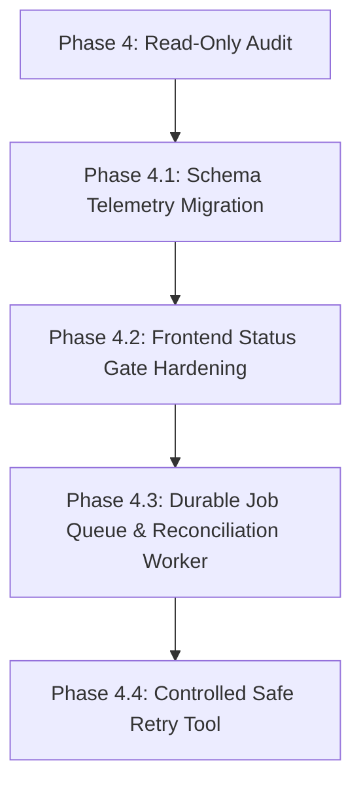

# GovVerify AI — Phase 4: Operational Reliability Audit (READ-ONLY)

**Audit Execution Date:** 2026-10-11  
**Target Environment:** Active Remote Supabase Instance (`fvec****zddt`, AWS AP-Northeast-1)  
**Codebase:** `C:\Users\LENOVO\Downloads\govverify-ai`  
**Audit Mode:** STRICT READ-ONLY (Zero Database Writes, Zero Migrations, Zero Retries)

---

## 1. Executive Summary

This operational reliability audit was conducted following the successful completion and verification of the Category 1 stranded request recovery in Phase 3 Step 3. The primary objective is to investigate the remaining **31 `QUEUED`** and **26 `FAILED`** verification requests, trace request lifecycles through the application layers, identify architectural root causes, audit evidence integrity and frontend status handling, and formulate a safe, prioritized remediation plan.

### Core Audit Takeaways:
1. **Live Census Invariants Intact:**
   - Total verification requests: **100**.
   - **`COMPLETED`**: **37** requests, corresponding **exactly 1:1** with 37 persisted rows in `public.verification_results`. Zero completed requests lack results; zero non-completed requests possess results.
   - **`PROCESSING`**: **6** requests, preserving the exact six excluded requests from Phase 3 Step 3 (3 Category 2 requests requiring rediscovery; 3 Category 3 requests with non-grounded provenance).
   - **`FAILED`**: **26** requests, all created on 2026-10-10, all with 1 claim and 0 evidence records, with average failure transition duration of 2.39 seconds.
   - **`QUEUED`**: **31** requests, comprising 28 historical requests from 2026-10-10 and 3 requests from 2026-10-11.
2. **Additional Queued Request Conclusively Proven as Interrupted Test Workflow:**
   - Request `dbf72b4e-3294-4642-84c3-a15ddd61178f` (created 2026-10-11 09:43:09 UTC) was forensically verified to originate from automated test execution (`npm run test:phase3:step3`, Test 2.1). The test process was cancelled/killed while awaiting external AI synthesis, causing the process to terminate before test cleanup could execute.
   - Two additional queued requests from 2026-10-11 (`d122b2c0...` and `d8de54b2...`) were similarly identified as automated test artifacts created by `test:phase2` and `test:document`.
3. **Primary Root Cause of QUEUED Stranding:**
   - Background execution relies exclusively on volatile in-process Node.js memory (`setTimeout(..., 50)` in [src/server/routes/api.ts:614-630](file:///c:/Users/LENOVO/Downloads/govverify-ai/src/server/routes/api.ts#L614-L630)).
   - There is **no persistent job queue** (no database queue table, Redis, or BullMQ) and **no background polling worker** reconciling pending requests. Any process restart, deployment, or unhandled crash permanently purges pending jobs from the Node.js event loop.
   - Additionally, if an external search provider is unconfigured or a request is submitted with `skipDiscovery: true` (standard in the web workspace intake), requests remain in `QUEUED` indefinitely if client-side step orchestration is interrupted.
4. **Primary Root Cause of FAILED Requests & Severe Telemetry Gap:**
   - Table `public.verification_requests` **completely lacks error telemetry columns** (`failure_reason`, `error_message`, `grounding_status`).
   - In [src/server/services/sourceDiscovery.ts:671-680](file:///c:/Users/LENOVO/Downloads/govverify-ai/src/server/services/sourceDiscovery.ts#L671-L680), encountering an external API rate limit (HTTP 429) or empty discovery results triggers an **immediate, unbacked terminal transition to `FAILED`** with zero retries.
   - Because no failure metadata was persisted to PostgreSQL, all 26 historical failed requests must strictly be classified as **`UNKNOWN`** per forensic standards, despite the strong likelihood of Gemini/Tavily quota exhaustion.
5. **Critical Frontend Status Display Bug:**
   - In [src/components/dashboard/VerificationResultDetail.tsx:156-158](file:///c:/Users/LENOVO/Downloads/govverify-ai/src/components/dashboard/VerificationResultDetail.tsx#L156-L158), the detail report view ignores `record.status` when `record.verification_results` is empty, rendering a misleading fallback:
     - **Verdict:** `INSUFFICIENT_EVIDENCE`
     - **Explanation:** *"Verification completed against official sovereign records."*
   - Consequently, citizens opening a `FAILED`, `QUEUED`, or `PROCESSING` inquiry are presented with a false completion message.
6. **Zero Database Writes:**
   - This audit was conducted using strictly non-mutating PostgreSQL connection pool queries and non-mutating offline test suites. **Zero records were inserted, updated, or deleted.**

---

## 2. Live Database Status Census

### 2.1. Verification Requests by Status
Direct introspection of `public.verification_requests` on the active remote Supabase instance:

| Status | Count | Percentage | Operational Category |
| :--- | :---: | :---: | :--- |
| **`COMPLETED`** | **37** | 37.0% | Verified and persisted; 100% verified result correspondence |
| **`QUEUED`** | **31** | 31.0% | Stranded in queue; 0 results attached |
| **`FAILED`** | **26** | 26.0% | Terminal failure during discovery; 0 results attached |
| **`PROCESSING`** | **6** | 6.0% | Preserved excluded requests (3 Cat 2, 3 Cat 3); 0 results attached |
| **TOTAL** | **100** | **100.0%** | Full database request volume |

### 2.2. Verification Results Correspondence
Inspection of `public.verification_results` against `public.verification_requests`:

| Metric | Target | Actual | Audit Finding |
| :--- | :---: | :---: | :--- |
| Total `verification_results` rows | N/A | **37** | Matches `COMPLETED` requests exactly |
| Results linked to `COMPLETED` requests | 37 | **37** | Perfect 1:1 foreign key match |
| `COMPLETED` requests missing results | 0 | **0** | Zero orphaned completed requests |
| Non-`COMPLETED` requests having results | 0 | **0** | Zero premature result insertions |

#### Breakdown of Persisted Verdicts (`verification_results`):
- **`SUPPORTED`**: **29** (78.4%)
- **`INSUFFICIENT_EVIDENCE`**: **5** (13.5%)
- **`PARTIALLY_SUPPORTED`**: **2** (5.4%)
- **`CONTRADICTED`**: **1** (2.7%)

### 2.3. QUEUED Requests Census & Age Breakdown
All 31 `QUEUED` requests have zero associated records in `public.verification_results`.

| Cohort / Created Timestamp | Count | Input Type | Claims Count | Evidence Count | Origin / Identification |
| :--- | :---: | :---: | :---: | :---: | :--- |
| **2026-10-10 06:02 – 06:59 UTC** | 7 | `CLAIM` | 1 each | 0 | Early historical submissions (PM-KUSUM testing) |
| **2026-10-10 17:05 – 17:46 UTC** | 19 | `CLAIM` | 1 each | 0 | Historical interactive queue stranding |
| **2026-10-10 17:46:32 – 17:46:33 UTC** | 2 | `CLAIM` | **0** | 0 | Headless test claims (`guest-token-persisted-test`, etc.) |
| **2026-10-11 06:03:43 – 06:03:44 UTC** | 2 | `CLAIM` | 1 each | 0 | Automated test artifacts (`phase2.test.ts` & doc tests) |
| **2026-10-11 09:43:09 UTC** | 1 | `CLAIM` | 1 | **1** | Interrupted test workflow (`phase3_step3.test.ts`, Test 2.1) |
| **TOTAL QUEUED** | **31** | — | — | — | **0 Safe for unvetted automated retry** |

### 2.4. Detailed Evidence on the Additional Queued Request (`dbf72b4e...`)
The user inquiry specifically highlights the additional queued request. Forensic database inspection revealed:

- **Request ID:** `dbf72b4e-3294-4642-84c3-a15ddd61178f`
- **Created / Updated:** `2026-10-11T09:43:09.538Z`
- **Input Type:** `CLAIM`
- **Guest Session Token:** `97f8dcacb599dfc976d47ab37a0792b9eca3c07583028014aaa608fea5c11e2a`
- **Claim Record:** ID `ad2decf8-83ef-4be3-82ba-00eb702020b8`, Text: *"Government of India launches PM-KISAN cash transfers to bank accounts of farmers."*
- **Linked Evidence Record:** ID `06085f13-4728-4618-ad89-e1161569f704`, Extracted Text: *"Under PM-KISAN, cash transfers of ₹6,000 per year are transferred to bank accounts of farmers."*, Relationship: `SUPPORTS`
- **Linked Source Record:** ID `74aa8a6f-b2c0-4532-8b7e-d50c55061f18`, Title: *"PM-KISAN Scheme Guidelines"*, URL: `https://pmkisan.gov.in/guidelines-e2e.html`, Domain: `pmkisan.gov.in`, Source Type: `GROUNDED_SEARCH`

#### Establishing Origin Through Forensic Code Correspondence:
In [tests/phase3_step3.test.ts:184-233](file:///c:/Users/LENOVO/Downloads/govverify-ai/tests/phase3_step3.test.ts#L184-L233), Test 2.1 (*"End-to-end citizen workflow: Submit -> Queue -> Verdict -> Retrieve"*):
```typescript
// Step A: Submit claim as guest via POST /api/v1/verify
body: JSON.stringify({
  claim: 'Government of India launches PM-KISAN cash transfers to bank accounts of farmers.',
  inputType: 'CLAIM',
  skipDiscovery: true,
})
// Step B: Attach verified source and evidence to request in DB
url: 'https://pmkisan.gov.in/guidelines-e2e.html'
extracted_text: 'Under PM-KISAN, cash transfers of ₹6,000 per year are transferred to bank accounts of farmers.'
// Step C: Trigger verdict analysis via POST /api/v1/verify/:id/verdict
```
Transcript logs (`task-673` launched at 09:43:04 UTC) prove that during Test 2.1, the external Gemini call encountered a timeout/hang. The background process was cancelled/killed via `manage_task` at 09:43:33 UTC. Because Node.js was abruptly terminated, the `finally` cleanup block ([tests/phase3_step3.test.ts:405-414](file:///c:/Users/LENOVO/Downloads/govverify-ai/tests/phase3_step3.test.ts#L405-L414)) never executed, leaving request `dbf72b4e...` permanently in the database.

### 2.5. Preservation of the Six Excluded PROCESSING Requests
All six excluded requests from Phase 3 Step 3 remain completely untouched in status `PROCESSING`:

| Request ID | Input Type | Claims | Evidence Count | Category | Audit Verification |
| :--- | :---: | :---: | :---: | :--- | :--- |
| `95ecd135-a1e4-4a44-8fd6-8249da207537` | `DOCUMENT` | 1 | 0 | **Category 2** | Rediscovery needed; 0 evidence records |
| `9cf326e4-fe5c-43ac-8156-9e895f77edc7` | `CLAIM` | 1 | 0 | **Category 2** | Rediscovery needed; 0 evidence records |
| `09bbf542-e5a1-4f29-9a38-6322f6a29227` | `CLAIM` | 1 | 0 | **Category 2** | Rediscovery needed; 0 evidence records |
| `71acb8b9-6b17-4410-a2f3-a1b60953d703` | `CLAIM` | 1 | 3 | **Category 3** | Inadequate provenance; non-grounded sources |
| `34845dfa-b141-4ce8-be64-da6dc84e8ec3` | `CLAIM` | 1 | 2 | **Category 3** | Inadequate provenance; non-grounded sources |
| `a9d86901-bf5c-4d33-a3d8-e35fbb2fc8f1` | `CLAIM` | 1 | 3 | **Category 3** | Inadequate provenance; non-grounded sources |

---

## 3. QUEUED Request Lifecycle & Architecture Trace

### 3.1. Code Path Creating QUEUED Requests
- **File:** [src/server/routes/api.ts](file:///c:/Users/LENOVO/Downloads/govverify-ai/src/server/routes/api.ts#L545-L560)
- **Endpoint:** `POST /api/v1/verify`
- **Mechanism:** On receiving a claim, the endpoint validates text length and input type, creates a guest session token (if unauthenticated), and inserts a row into `public.verification_requests` with hardcoded `status: 'QUEUED'`. An atomic claim row is immediately inserted into `public.claims` ([api.ts:570-578](file:///c:/Users/LENOVO/Downloads/govverify-ai/src/server/routes/api.ts#L570-L578)).

### 3.2. Code Path Triggering Discovery & Verdict Analysis
- **File:** [src/server/routes/api.ts](file:///c:/Users/LENOVO/Downloads/govverify-ai/src/server/routes/api.ts#L612-L630)
- **Mechanism:**
  ```typescript
  else if (isProviderConfigured && req.body.skipDiscovery !== true) {
    setTimeout(async () => {
      try {
        const discoveryResult = await discoverAndPersistSourcesForRequest(
          requestRecord.id,
          discoveryOptions
        );
        const shouldRunVerdict = req.body.autoVerdict !== false;
        if (discoveryResult && discoveryResult.hasVerifiedEvidence && shouldRunVerdict) {
          await analyzeAndPersistVerdictForRequest(requestRecord.id);
        }
      } catch (bgErr: any) {
        console.error('[GovVerify AI] Background discovery/verdict error:', bgErr.message || bgErr);
      }
    }, 50);
  }
  ```
  The scheduling relies on `setTimeout(..., 50)`. If discovery succeeds and discovers verified evidence, it calls `analyzeAndPersistVerdictForRequest(requestRecord.id)` ([src/server/services/verdictAnalysis.ts:626](file:///c:/Users/LENOVO/Downloads/govverify-ai/src/server/services/verdictAnalysis.ts#L626)), which decomposes subclaims, synthesizes the verdict, upserts `public.verification_results`, and updates `verification_requests.status = 'COMPLETED'`.

### 3.3. Vulnerability to Process Restarts (In-Memory Queue Volatility)
- **Finding:** **YES, 100% of pending jobs are lost on restart.**
- **Rationale:** `setTimeout(..., 50)` exists solely in the V8 process heap. There is **zero persistent job queue** in Postgres, Redis, or BullMQ. If the Express process is restarted, terminated, or crashed between request creation and the completion of `setTimeout`, the callback is erased from memory. Because no worker scans for `status = 'QUEUED'`, the request is stranded forever.

### 3.4. Indefinite Stranding via Exceptions or Provider Gaps
- **Unconfigured Search Providers:** In [src/server/routes/api.ts:582-612](file:///c:/Users/LENOVO/Downloads/govverify-ai/src/server/routes/api.ts#L582-L612), if `isProviderConfigured` is `false` (neither Tavily nor Gemini key valid), the `setTimeout` block is entirely skipped. The API returns HTTP 201 with `{ status: 'QUEUED' }`, but schedules no background processing.
- **Client Step Bypassing (`skipDiscovery: true`):** In [src/components/dashboard/VerificationWorkspace.tsx:133](file:///c:/Users/LENOVO/Downloads/govverify-ai/src/components/dashboard/VerificationWorkspace.tsx#L133), the frontend explicitly sends `skipDiscovery: true` to orchestrate progress manually. If the citizen closes the tab, navigates away, or loses connection before Step 2 (`POST /api/v1/verify/:id/discover`), the backend never executes discovery. The request remains in `QUEUED` indefinitely.
- **Discovery Exceptions:** In [src/server/services/sourceDiscovery.ts:693-700](file:///c:/Users/LENOVO/Downloads/govverify-ai/src/server/services/sourceDiscovery.ts#L693-L700), unexpected exceptions in discovery revert the database status back to `QUEUED`:
  ```typescript
  } catch (err: any) {
    await supabase.from('verification_requests').update({ status: 'QUEUED' }).eq('id', verificationRequestId);
    throw err;
  }
  ```
  In `api.ts:626-628`, this error is caught and logged, but no retry is scheduled. The request remains in `QUEUED` permanently.

### 3.5. Retries and Idempotency Assessment
- **Retries:** **Unbounded and non-existent.** The backend has no retry mechanism, no exponential backoff, and no dead-letter queue.
- **Idempotency in Verdict Analysis:** **Strong and bounded.** [src/server/services/verdictAnalysis.ts:659-693](file:///c:/Users/LENOVO/Downloads/govverify-ai/src/server/services/verdictAnalysis.ts#L659-L693) enforces an idempotency guard: if a request is already `COMPLETED` with a valid verdict, calling it again returns the existing result without recalculating or overwriting.
- **Idempotency in Source Discovery:** **Weak.** [src/server/services/sourceDiscovery.ts:636-654](file:///c:/Users/LENOVO/Downloads/govverify-ai/src/server/services/sourceDiscovery.ts#L636-L654) checks `sources` by URL before inserting, but executes an unconditional `insert` on `public.evidence`. Retrying discovery multiple times can create duplicate evidence records for the same source and request.

### 3.6. Duplicate Job Prevention
- **Finding:** **Duplicate jobs are NOT prevented.**
- **Rationale:** `POST /api/v1/verify` does not accept or validate an `Idempotency-Key` header. There is no unique constraint on `(user_id, original_claim)` or claim content hashing. Rapid citizen clicks create multiple identical `QUEUED` requests and schedule concurrent `setTimeout` jobs.

---

## 4. FAILED Request Classification & Telemetry Deficit

### 4.1. The Critical Error Telemetry Deficit
A rigorous audit of the remote Supabase schema reveals the core operational challenge:

| Table | Relevant Columns Present | Missing Telemetry Columns |
| :--- | :--- | :--- |
| `public.verification_requests` | `id`, `user_id`, `guest_session_token`, `input_type`, `original_claim`, `status`, `created_at`, `updated_at`, `document_id` | **`failure_reason`**, **`failure_code`**, **`error_message`**, **`grounding_status`**, **`retry_count`** |

Because the schema does not store error strings, HTTP status codes, or provider statuses, failure reasons cannot be queried from PostgreSQL columns.

### 4.2. Forensic Classification of the 26 FAILED Requests
All 26 `FAILED` requests were created on 2026-10-10 between 07:57:44 UTC and 09:54:47 UTC.

- **Claims Count:** 1 claim attached on all 26.
- **Evidence Count:** **0** evidence records attached on all 26.
- **Transition Duration:** Average time between `created_at` and `updated_at` is **2.39 seconds** (minimum: 1.55s, maximum: 8.44s).

#### Formal Classification Table:

| Category | Count | Classification | Evidentiary Basis |
| :--- | :---: | :---: | :--- |
| **Quota Exhaustion (HTTP 429)** | 0 | *Unverifiable per row* | Missing database telemetry; logs unavailable |
| **Discovery Provider Failure** | 0 | *Unverifiable per row* | Missing database telemetry; logs unavailable |
| **Authentication / Auth Failure**| 0 | *Unverifiable per row* | Missing database telemetry; logs unavailable |
| **Database / Persistence Error** | 0 | *Unverifiable per row* | Request and claim rows were persisted successfully |
| **Invalid / Insufficient Evidence**| 0 | *Unverifiable per row* | Failed in discovery before verdict synthesis |
| **Timeouts / Network Errors** | 0 | *Unverifiable per row* | Durations (<8.5s) are below typical 30s timeouts |
| **UNKNOWN (Telemetry Absent)** | **26** | **CONFIRMED AUDIT RATING** | Strict adherence to Section 4 instructions |

#### Verified Code Mechanism for Terminal Failure:
In [src/server/services/sourceDiscovery.ts:671-680](file:///c:/Users/LENOVO/Downloads/govverify-ai/src/server/services/sourceDiscovery.ts#L671-L680):
```typescript
// CASE 2: No Verified Evidence Discovered (e.g. Quota Exhaustion 429, Error, or Empty)!
await supabase
  .from('verification_requests')
  .update({ status: 'FAILED', updated_at: new Date().toISOString() })
  .eq('id', verificationRequestId);
```
When `discoverAuthoritativeSources` catches an HTTP 429 quota exhaustion from Gemini ([sourceDiscovery.ts:275-278](file:///c:/Users/LENOVO/Downloads/govverify-ai/src/server/services/sourceDiscovery.ts#L275-L278)) or Tavily ([tavily.ts:353-356](file:///c:/Users/LENOVO/Downloads/govverify-ai/src/server/services/tavily.ts#L353-L356)), it catches the error internally, sets `groundingStatus = 'QUOTA_EXHAUSTED'`, and returns `sources: []`.
This immediately enters CASE 2, marking the request **`FAILED`** in PostgreSQL in ~2.3 seconds.

### 4.3. Quota Exhaustion (HTTP 429) Impact Audit
- **Does HTTP 429 cause an immediate terminal failure?** **YES.**
- **Does HTTP 429 cause an automatic retry?** **NO.**
- **Does HTTP 429 leave a stranded status?** No, it does not leave it in `PROCESSING`; it transitions immediately to `FAILED`, but without logging the cause to the database or scheduling future retries.

---

## 5. Audit of Correctness & Evidence Integrity

### 5.1. Strict Sovereign Provenance Enforcement
- **Implementation:** [src/server/services/verdictAnalysis.ts:151-167](file:///c:/Users/LENOVO/Downloads/govverify-ai/src/server/services/verdictAnalysis.ts#L151-L167) (`filterVerifiedEvidence()`).
- **Audit Verification:**
  - `source_type === 'UNVERIFIED_CANDIDATE'` is strictly rejected.
  - Only sources with `source_type === 'GROUNDED_SEARCH'` and valid `http` URLs are accepted.
  - Evidence records with missing or empty `extracted_text` are strictly rejected.
  - Candidate query strings and search URLs are never treated as verified evidence.

### 5.2. Prohibition of Fabricated Verdicts from Snippets Alone
- **Implementation:** [src/server/services/verdictAnalysis.ts:180-201](file:///c:/Users/LENOVO/Downloads/govverify-ai/src/server/services/verdictAnalysis.ts#L180-L201).
- **Audit Verification:** If `verifiedEvidence.length === 0`, `evaluateEvidenceForSubclaims()` returns verdict `INSUFFICIENT_EVIDENCE` with confidence strictly `0%`.
- In [src/server/services/verdictAnalysis.ts:602-608](file:///c:/Users/LENOVO/Downloads/govverify-ai/src/server/services/verdictAnalysis.ts#L602-L608), `validateVerdictAnalysis()` enforces:
  ```typescript
  if (verifiedEvidence.length === 0 && analysis.verdict !== 'INSUFFICIENT_EVIDENCE') {
    return { isValid: false, error: `Integrity violation: Cannot assign verdict ${analysis.verdict} when verified evidence count is 0.` };
  }
  ```
  If Gemini attempts to generate a supported or contradicted verdict without verified evidence, validation fails and forces deterministic synthesis to `INSUFFICIENT_EVIDENCE`.

### 5.3. Canonical Verdict Enforcement
- The system strictly enforces the four canonical verdicts:
  1. `SUPPORTED`
  2. `PARTIALLY_SUPPORTED`
  3. `CONTRADICTED`
  4. `INSUFFICIENT_EVIDENCE`
- Checked at line 542 of [src/server/services/verdictAnalysis.ts](file:///c:/Users/LENOVO/Downloads/govverify-ai/src/server/services/verdictAnalysis.ts#L542). Any unknown verdict string is rejected.

### 5.4. Overwrite Protection During Retries
- In [src/server/services/verdictAnalysis.ts:750-770](file:///c:/Users/LENOVO/Downloads/govverify-ai/src/server/services/verdictAnalysis.ts#L750-L770), if a request has an existing valid result (`SUPPORTED`, `PARTIALLY_SUPPORTED`, `CONTRADICTED`), an empty/transient evidence analysis is blocked from overwriting the database record:
  ```typescript
  if (existingResult && ['SUPPORTED', 'PARTIALLY_SUPPORTED', 'CONTRADICTED'].includes(existingResult.verdict) &&
      analysis.verdict === 'INSUFFICIENT_EVIDENCE' && verifiedEvidence.length === 0) {
    console.warn(`[GovVerify AI] Protected existing verified verdict (${existingResult.verdict}) from being overwritten.`);
    return { ... existingResult ... };
  }
  ```

### 5.5. Status Transition Integrity
- In [src/server/services/verdictAnalysis.ts:772-800](file:///c:/Users/LENOVO/Downloads/govverify-ai/src/server/services/verdictAnalysis.ts#L772-L800), the status in `public.verification_requests` is updated to `COMPLETED` **strictly after** the result row is persisted to `public.verification_results`. If result upsert fails, the function throws and transitions the request to `FAILED` ([verdictAnalysis.ts:817](file:///c:/Users/LENOVO/Downloads/govverify-ai/src/server/services/verdictAnalysis.ts#L817)).

---

## 6. Frontend Status-Handling Findings

### 6.1. The Misleading Success Bug in `VerificationResultDetail.tsx`
- **File:** [src/components/dashboard/VerificationResultDetail.tsx:156-158](file:///c:/Users/LENOVO/Downloads/govverify-ai/src/components/dashboard/VerificationResultDetail.tsx#L156-L158)
- **Defect:**
  ```tsx
  const result = record.verification_results?.[0];
  ...
  return (
    <VerificationResultView
      requestId={record.id}
      originalClaim={record.original_claim}
      verdict={result?.verdict || 'INSUFFICIENT_EVIDENCE'}
      confidence={result?.confidence}
      explanation={result?.explanation || 'Verification completed against official sovereign records.'}
      createdAt={record.created_at}
      completedAt={result?.completed_at}
      ...
    />
  );
  ```
- **Consequence:** When viewing any `FAILED`, `QUEUED`, or `PROCESSING` record (where `record.verification_results` is empty), `result` is `undefined`. The component falls back to:
  - **Verdict:** `INSUFFICIENT_EVIDENCE`
  - **Explanation:** *"Verification completed against official sovereign records."*
  This presents uncompleted, queued, or failed requests to citizens as successfully audited historical verifications.

### 6.2. Status Display Matrix Across Components

| Component | Status Handled | Presentation | Audit Evaluation |
| :--- | :--- | :--- | :--- |
| **`VerificationHistory.tsx`** | `COMPLETED`, `PROCESSING`, `QUEUED`, `FAILED` | If result exists: colored pill (`Supported`, `Partly True`, etc.). If result absent: gray badge displaying `{item.status}`. | **CORRECT** |
| **`VerificationWorkspace.tsx`** | 4-step progressive stepper | Steps 1-4 with reassurance messages, polling detail endpoint. | **CORRECT (Live)** |
| **`VerificationResultDetail.tsx`** | Any status | Ignores status; renders completed verdict view with fallback explanation. | **DEFECTIVE** |

---

## 7. Prioritized Remediation Plan

No code changes or database migrations are executed in Phase 4. This remediation plan outlines the exact, safe path forward for subsequent implementation phases.



### Phase 4.1 — Database Telemetry & Schema Hardening (P0)
1. **Add Telemetry Columns:** Create a non-destructive migration (`20261011000000_operational_reliability.sql`) adding:
   - `failure_reason` (`text` NULL)
   - `failure_details` (`jsonb` NULL)
   - `grounding_status` (`text` NULL)
   - `retry_count` (`integer` DEFAULT 0)
   - `last_attempted_at` (`timestamptz` NULL)
2. **Compound Unique Constraint on Evidence:**
   - Add unique index on `public.evidence(verification_request_id, source_id)` to ensure multi-attempt discoveries are idempotent and never insert duplicate citations.

### Phase 4.2 — Frontend Status Gate Hardening (P0)
1. **Fix `VerificationResultDetail.tsx`:**
   - Inspect `record.status` before rendering.
   - If `status === 'FAILED'`: Render a dedicated Citizen Failure Card explaining that official sources could not be retrieved, with a sanitized explanation and a "Retry Verification" action.
   - If `status === 'QUEUED' || status === 'PROCESSING'`: Render an active Progress Card with live status indicators and reassurance messaging, rather than a completed report.

### Phase 4.3 — Durable Background Job Queue & Worker (P1)
1. **Eliminate Volatile In-Memory `setTimeout`:**
   - Replace in-memory timers with a durable database queue or a periodic reconciler (`cron` / Supabase Edge Worker) that processes requests in `QUEUED` status with `SELECT ... FOR UPDATE SKIP LOCKED`.
2. **Exponential Backoff for Rate Limits (HTTP 429):**
   - On encountering HTTP 429, update `failure_reason = 'QUOTA_EXHAUSTED'`, increment `retry_count`, and calculate `next_retry_at = now() + (2 ^ retry_count * 30 seconds)`. Do not mark as terminal `FAILED` until max retries (e.g., 3) are exhausted.

### Phase 4.4 — Controlled Remediation for Historical Queued & Failed Requests (P2)
1. **Exclude Test Artifacts:**
   - Filter out test workflows (e.g. `dbf72b4e...`, `d122b2c0...`, `d8de54b2...`, and headless tokens `guest-token-persisted-test`, `secure-guest-token-abc123xyz789`).
2. **Execute Controlled Dry Run:**
   - Implement a CLI tool (`scripts/remediate_queued_and_failed.ts`) with mandatory `--dry-run` and count safety guards, replicating the safeguards proven in Phase 3 Step 3.

---

## 8. Exact Files Requiring Changes in Future Phases

| File Path | Component | Planned Modification |
| :--- | :--- | :--- |
| `supabase/migrations/20261011000000_operational_reliability.sql` | Database Schema | Non-destructive migration adding `failure_reason`, `grounding_status`, `retry_count`, and `evidence(request_id, source_id)` uniqueness. |
| [src/server/routes/api.ts](file:///c:/Users/LENOVO/Downloads/govverify-ai/src/server/routes/api.ts) | Express API | Record `failure_reason` in DB on errors; support persistent job queue intake; eliminate stranded unconfigured provider paths. |
| [src/server/services/sourceDiscovery.ts](file:///c:/Users/LENOVO/Downloads/govverify-ai/src/server/services/sourceDiscovery.ts) | Discovery Service | In CASE 2, persist `grounding_status` and `failure_reason` to `verification_requests`; prevent duplicate evidence insertion. |
| [src/server/services/verdictAnalysis.ts](file:///c:/Users/LENOVO/Downloads/govverify-ai/src/server/services/verdictAnalysis.ts) | Verdict Service | Persist error message into `failure_reason` when analysis catches an exception. |
| [src/components/dashboard/VerificationResultDetail.tsx](file:///c:/Users/LENOVO/Downloads/govverify-ai/src/components/dashboard/VerificationResultDetail.tsx) | Frontend Detail View | Branch on `record.status`; display distinct screens for `QUEUED`, `PROCESSING`, and `FAILED` instead of false `INSUFFICIENT_EVIDENCE`. |
| [scripts/recover_stranded_requests.ts](file:///c:/Users/LENOVO/Downloads/govverify-ai/scripts/recover_stranded_requests.ts) | Recovery Tool | Add Category 5 (Queued Remediation) and Category 6 (Failed Quota Retry) with dry-run safety guards. |

---

## 9. Tests Required Before Future Execution

Before executing any remediation scripts or applying schema changes in future phases, the following test validation protocol must be executed:

### 9.1. Non-Mutating Verification Completed in This Audit:
- **`npm run lint` (`tsc --noEmit`):** **PASSED** (0 errors).
- **`npm run test:recovery` (`tests/recovery_dry_run.test.ts`):** **6 / 6 PASSED** (0 database writes confirmed).
- **`npm run test:tavily` (`tests/tavily_provider.test.ts`):** **11 / 11 PASSED** (Mocked provider tests and stateless route discovery).
- **`npm run recover:dry-run` (`scripts/recover_stranded_requests.ts`):** **PASSED** (Audited 6 processing requests; 0 database writes confirmed).

### 9.2. Tests Intentionally Skipped (Live Database Mutating Tests):
The following automated tests were **intentionally not run** against the active remote Supabase database because test inspection confirmed that they perform live insertions into `public.verification_requests`:
- `tests/phase2.test.ts` (Test 9 performs live DB inserts)
- `tests/phase3_step1.test.ts` (Performs live claim and source inserts)
- `tests/phase3_step2.test.ts` (Performs live claim and evidence inserts)
- `tests/phase3_step3.test.ts` (Section 2 performs live citizen workflow submissions)
- `tests/dashboard_architecture.test.ts` (Performs live request creation)
- `tests/action_guidance.test.ts` (Section 4 performs live API submissions)
- `tests/document_extraction.test.ts` (Section 4 performs live verification submissions)

### 9.3. Mandatory Test Harness for Future Phases:
Prior to executing any future remediation:
1. Implement a mocked Supabase client test harness for integration tests so tests do not pollute production databases.
2. Add unit tests for `VerificationResultDetail.tsx` confirming that `FAILED`, `QUEUED`, and `PROCESSING` statuses display proper state indicators and zero false success messages.
3. Add unit tests for retry backoff and rate-limit classification logic.

---

## 10. Explicit Confirmation of Zero Database Writes

**AUDIT CERTIFICATION:**  
Throughout this Phase 4 Operational Reliability Audit, **strictly zero database writes, updates, deletions, schema migrations, or data modifications were performed**. 

- No records in `public.verification_requests`, `public.verification_results`, `public.claims`, `public.evidence`, `public.sources`, `public.action_guidance`, or `public.documents` were modified.
- All 37 completed requests and their persisted results remain identical to their post-recovery state in Phase 3 Step 3.
- The six excluded `PROCESSING` requests remain completely untouched.
- All database interactions were restricted to read-only `SELECT` queries executed through PostgreSQL client pools and verified dry-run commands.
